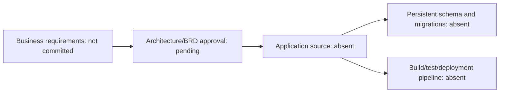

# SSV Decors — reverse-engineering evidence and architecture decision gate

> Inspected `varadatechworks/ssv-decors` `main` on 10 Nov 2026. **No application source exists in the current repository tree**; the only file is the previously added [technical handover README](../../README.md). Reverse-engineering a deployable architecture, physical ER or migration script from non-existent code is not possible.

## Repo evidence
- [`README.md`](https://github.com/varadatechworks/ssv-decors/blob/main/README.md)

## Architecture evidence

**Do not misrepresent** this illustrative decision flow as a deployed system or a completed technical design.

## Documentation and implementation required before UAT
- Define stakeholders, functional scope, roles, customer journey, acceptance tests, integrations and security requirements in reviewed BRD/SRS.
- Select runtime, web/mobile channels, hosting model, authentication, data retention, backup/restore, deployments and SLAs.
- Create source, working builds and approved migration/schema with a development DB before generating a physical ER.
- Add CI, deployment scripts, environment templates, logs/alerts, negative tests, automated coverage and KT screens; only then run installation and UAT.
- Confirm ownership, rollout budget and whether this repo is intended for a static marketing site or a transactional service. This cannot be concluded from the name alone.

## KT state
**Status: blocked — application does not exist in GitHub.** Only the repository inventory and prerequisites can be completed honestly today. The earlier [README](../../README.md) is a planning/KT reference, not the source of deployed functionality.
